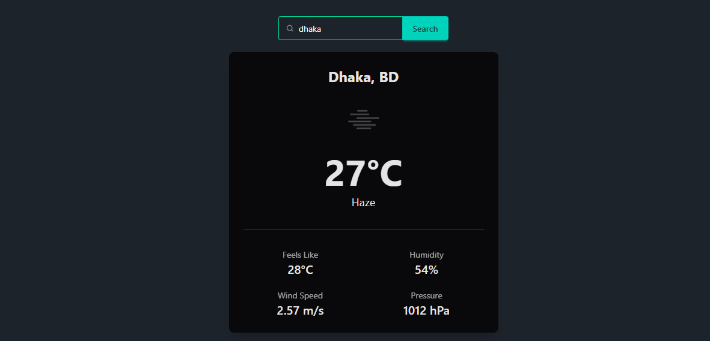
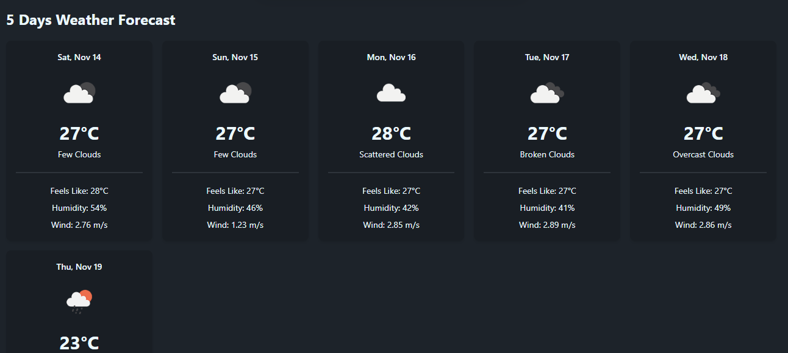

# 🌦️ Weather App (Redux)

A modern weather application built with **React**, **Redux Toolkit**, and **OpenWeather API**. This app allows users to search for any city and view real-time weather information, including temperature, humidity, wind speed, and weather conditions.
## 🚀 Features

- 🔍 Search weather by city name
- 🌡️ Real-time temperature display
- 💨 Wind speed information
- 💧 Humidity details
- 🌤️ Weather condition icons
- ⚡ Global state management with Redux Toolkit
- 📱 Responsive design for mobile and desktop
- ❌ Error handling for invalid city names
- ⏳ Loading state while fetching weather data

## 🛠️ Technologies Used

- React.js
- Redux Toolkit
- React Redux
- Axios
- OpenWeather API
- Tailwind CSS (Optional)
- Vite

